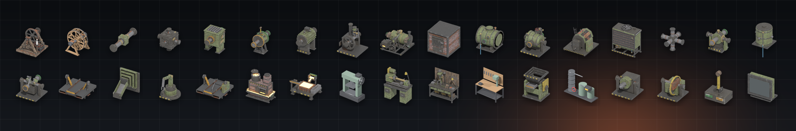
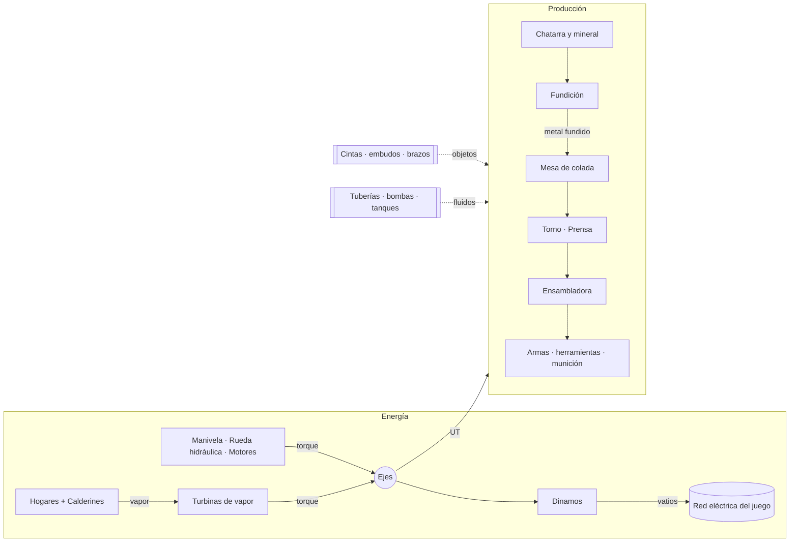

<div align="center">


<br />

[English](README.md) · [Português (Brasil)](README.pt-BR.md) · **Español**

<br />

-c8501e?style=flat-square)


*Convierte chatarra en máquinas, máquinas en líneas de producción y líneas de producción en una industria de verdad.*

</div>

---

**ForgedInAshes** reemplaza el banco de trabajo de un clic por una industria real. El material cambia de forma en
cada paso — chatarra → metal fundido → pieza colada → pieza mecanizada → ensamblaje — y cada paso funciona con una
energía que construyes tú mismo: **torque**, **vapor**, **electricidad**, **calor** o **presión**. Los ejes giran,
las cintas transportan, las tuberías se llenan, las calderas silban, y una bala de 9 mm sale al final de una línea
que tú diseñaste.

<div align="center">

</div>

## Lo más destacado

| | |
|---|---|
| ⚙️ **Redes de torque** | Ejes, cajas de transmisión, cajas de velocidad, embragues, reguladores e inversores de giro. Cada red tiene capacidad y carga en **UT**, velocidad en **RPM**, inercia de arranque y sobrecarga. |
| 🔥 **Vapor modular** | Construye una central del tamaño que quieras: los hogares calientan calderines, el vapor mueve turbinas y las dinamos en el mismo eje alimentan la red eléctrica del juego. |
| 🛢️ **Fluidos y gases** | Un fluido por red de tuberías, presión real en bar, tanques que se unen, compresores, cinco tipos de válvula y manómetros que emiten señales. |
| 📦 **Logística** | Cintas movidas por torque, embudos, brazos, divisores, filtros, contadores, toboganes, bóvedas y **estaciones en línea** que trabajan sobre el objeto mientras pasa. |
| 🏭 **Cadenas de producción** | 223 procesos en 56 máquinas. 552 de los 559 objetos fabricables del juego ahora salen de una cadena en lugar de un banco. |
| 🔌 **Señales** | Palancas, palancas analógicas, enlaces inalámbricos, receptores para el cableado del juego y paneles numéricos. |
| ⛏️ **Máquinas en el mundo** | Taladros, sierras, cosechadoras, colocadores y pistones que trabajan sobre el bloque de enfrente. |
| 🌳 **Nuevos recursos** | Árboles de caucho sangrados para látex, refinería de petróleo, biodigestores y química. |

> [!NOTE]
> ForgedInAshes está en desarrollo activo. Los valores de equilibrio cambian a menudo y el mod todavía no se ha
> probado en multijugador: juega en modo un jugador.

## Inicio rápido

1. **Requisitos** — 7 Days to Die **V3.4** (probado en b10), iniciado **sin EAC** (el mod incluye una DLL).
2. **Instalación** — copia la carpeta `Mods/ForgedInAshes` en `<carpeta del juego>/Mods/`.
3. **Juega** — empieza un mundo, fabrica una **Crank** (manivela) y un **Engineer's Manual** (manual del
   ingeniero) y sigue la Guía de Producción dentro del juego.

Instrucciones completas: **[Guía de instalación](docs/es/installation.md)**.

## Documentación

| Guía | Para | Contenido |
|---|---|---|
| 📥 [Instalación](docs/es/installation.md) | Jugadores | Requisitos, instalar, actualizar, desinstalar, multijugador |
| 🎮 [Guía de juego](docs/es/gameplay.md) | Jugadores | Primeros pasos, torque, fluidos, logística, central de vapor, señales, máquinas en el mundo |
| 🩺 [Solución de problemas](docs/es/troubleshooting.md) | Jugadores | Problemas comunes, registros, cómo informar un error |
| 🛠️ [Desarrollo](docs/es/development.md) | Colaboradores | Compilar desde el código fuente, herramientas, arquitectura, pipeline de assets |
| 🤝 [Cómo contribuir](CONTRIBUTING.md) | Colaboradores | Flujo de trabajo, convenciones, pull requests (en inglés) |

Toda la documentación está disponible en [English](docs/en/README.md), [Português (Brasil)](docs/pt-BR/README.md)
y [Español](docs/es/README.md).

## Cómo encaja todo



## Estructura del repositorio

```text
ForgedInAshes/
├─ Mods/ForgedInAshes/   El mod tal como lo carga el juego (XML, datos, iconos, paquete de modelos, DLL)
├─ src/ForgedInAshes/    Código C# de la DLL (parches Harmony, redes, máquinas, interfaz)
├─ tools/                Compilación, instalación, validadores y generadores de datos (PowerShell + Python)
├─ Art/                  Archivos de Blender y el proyecto de Unity que genera el paquete de modelos
├─ site/                 Sitio de tutoriales (Vite + React + three.js), generado a partir de los datos del mod
└─ docs/                 Esta documentación (en · pt-BR · es)
```

## Compilar desde el código fuente

```powershell
fe.bat          # menú interactivo
fe.bat mod      # valida el XML, compila la DLL y enlaza el mod en la carpeta del juego
fe.bat tudo     # modelos -> iconos -> mod, todo lo que cambió
fe.bat site     # modelos 3D, datos y compilación del sitio de tutoriales
```

Consulta **[Desarrollo](docs/es/development.md)** para los requisitos previos y el pipeline completo.

## Créditos

- **Diseño, código y dirección de arte:** Dário Jr ([@BirdRa1n](https://github.com/BirdRa1n)).
- Hecho con [Harmony](https://github.com/pardeike/Harmony) (incluido en el juego como `0_TFP_Harmony`),
  [Blender](https://www.blender.org/), [Unity](https://unity.com/), [Vite](https://vitejs.dev/),
  [React](https://react.dev/) y [three.js](https://threejs.org/).
- *7 Days to Die* es una marca registrada de The Fun Pimps. Este proyecto es un mod hecho por fans, sin relación ni
  aval de The Fun Pimps. Este repositorio no distribuye ningún archivo del juego.

## Licencia

Todavía no se ha elegido una licencia. Hasta que se publique una, el autor se reserva todos los derechos.

<div align="center">
<sub>ForgedInAshes · para supervivientes que prefieren construir una fábrica antes que otra estaca de madera.</sub>
</div>
