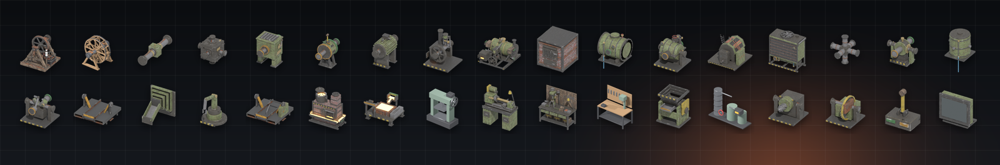
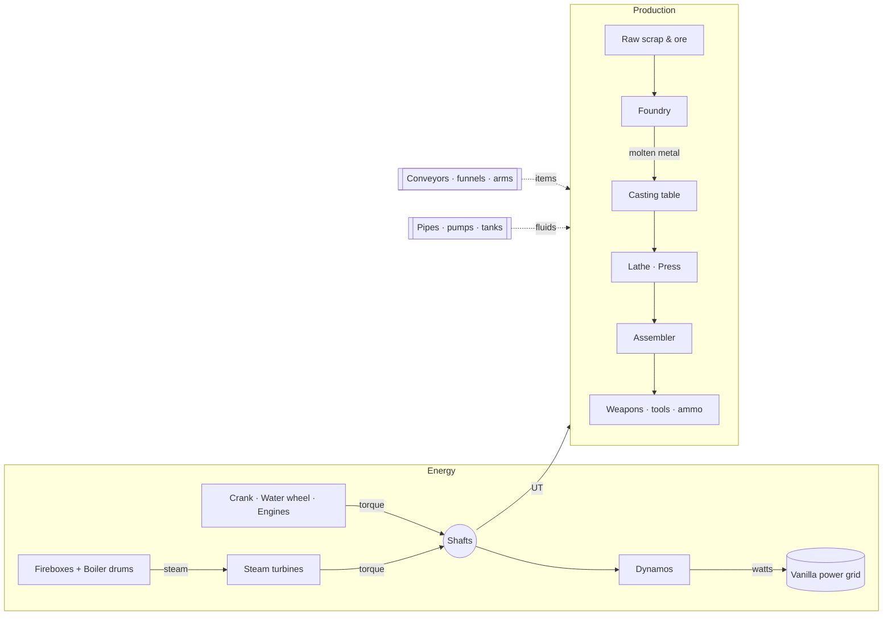

<div align="center">


<br />

**English** · [Português (Brasil)](README.pt-BR.md) · [Español](README.es.md)

<br />

-c8501e?style=flat-square)


*Turn scrap into machines, machines into production lines, and production lines into a working industry.*

</div>

---

**ForgedInAshes** replaces the one-click workbench with real industry. Materials change shape at every step —
scrap → molten metal → cast part → machined part → assembly — and every step runs on a form of energy you build
yourself: **torque**, **steam**, **electricity**, **heat** or **pressure**. Shafts turn, belts carry, pipes fill,
boilers hiss, and a 9 mm round comes out the other end of a line you designed.

<div align="center">

</div>

## Highlights

| | |
|---|---|
| ⚙️ **Torque networks** | Shafts, gearboxes, speed boxes, clutches, regulators and spin inverters. Every network has a capacity and a load in **UT**, a speed in **RPM**, start-up inertia and overload. |
| 🔥 **Modular steam power** | Build a power plant as big as you like: fireboxes heat boiler drums, steam drives turbines, dynamos on the same shaft feed the vanilla power grid. |
| 🛢️ **Fluids and gases** | One fluid per pipe network, real pressure in bar, tanks that merge, compressors, five valve types, gauges that emit signals. |
| 📦 **Logistics** | Conveyor belts driven by torque, funnels, arms, splitters, filters, counters, chutes, vaults and **in-line stations** that work on items as they pass. |
| 🏭 **Production chains** | 223 processes across 56 machines. 552 of 559 vanilla craftable items now come out of a chain instead of a single bench. |
| 🔌 **Signals** | Levers, analog levers, wireless links, receivers for vanilla wiring and numeric display panels. |
| ⛏️ **World machines** | Drills, saws, harvesters, deployers and pistons that work on the block in front of them. |
| 🌳 **New resources** | Rubber trees tapped for latex, an oil refinery, biodigesters, chemistry. |

> [!NOTE]
> ForgedInAshes is in active development. Balance values change often and the mod has not been tested on
> multiplayer yet — play it in single player.

## Quick start

1. **Requirements** — 7 Days to Die **V3.4** (tested on b10), launched **without EAC** (the mod ships a DLL).
2. **Install** — copy the `Mods/ForgedInAshes` folder into `<game folder>/Mods/`.
3. **Play** — start a world, craft a **Crank** and an **Engineer's Manual**, and follow the in-game Production Guide.

Full instructions: **[Installation guide](docs/en/installation.md)**.

## Documentation

| Guide | For | What's inside |
|---|---|---|
| 📥 [Installation](docs/en/installation.md) | Players | Requirements, install, update, uninstall, multiplayer status |
| 🎮 [Gameplay guide](docs/en/gameplay.md) | Players | First steps, torque, fluids, logistics, power plant, signals, world machines |
| 🩺 [Troubleshooting](docs/en/troubleshooting.md) | Players | Common problems, logs, how to report a bug |
| 🛠️ [Development](docs/en/development.md) | Contributors | Building from source, toolchain, architecture, asset pipeline |
| 🤝 [Contributing](CONTRIBUTING.md) | Contributors | Workflow, conventions, pull requests |

All documentation is available in [English](docs/en/README.md), [Português (Brasil)](docs/pt-BR/README.md) and
[Español](docs/es/README.md).

## How it fits together



## Repository layout

```text
ForgedInAshes/
├─ Mods/ForgedInAshes/   The mod as the game loads it (XML config, data, icons, asset bundle, DLL)
├─ src/ForgedInAshes/    C# source of the mod DLL (Harmony patches, networks, machines, UI)
├─ tools/                Build, install, validators and data generators (PowerShell + Python)
├─ Art/                  Blender sources, the Unity project that builds the asset bundle
├─ site/                 Tutorial website (Vite + React + three.js), generated from the mod data
└─ docs/                 This documentation (en · pt-BR · es)
```

## Building from source

```powershell
fe.bat          # interactive menu
fe.bat mod      # validate the XML, compile the DLL and link the mod into the game
fe.bat tudo     # models -> icons -> mod, everything that changed
fe.bat site     # 3D models, data and build of the tutorial site
```

See **[Development](docs/en/development.md)** for prerequisites and the full pipeline.

## Credits

- **Design, code and art direction:** Dário Jr ([@BirdRa1n](https://github.com/BirdRa1n)).
- Built with [Harmony](https://github.com/pardeike/Harmony) (shipped with the game as `0_TFP_Harmony`),
  [Blender](https://www.blender.org/), [Unity](https://unity.com/), [Vite](https://vitejs.dev/),
  [React](https://react.dev/) and [three.js](https://threejs.org/).
- *7 Days to Die* is a trademark of The Fun Pimps. This project is a fan-made mod and is not affiliated with or
  endorsed by The Fun Pimps. No game files are distributed in this repository.

## License

No license has been chosen yet. Until one is published, all rights are reserved by the author.

<div align="center">
<sub>ForgedInAshes · made for survivors who would rather build a factory than another wooden spike.</sub>
</div>
