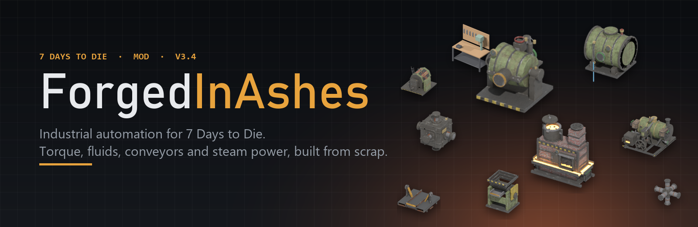
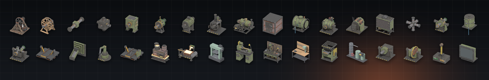
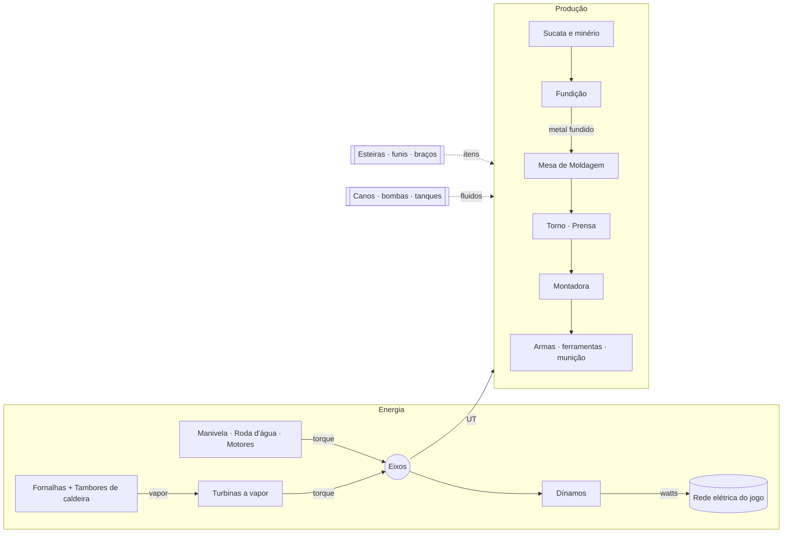

<div align="center">



<br />

[English](README.md) · **Português (Brasil)** · [Español](README.es.md)

<br />

-c8501e?style=flat-square)


*Transforme sucata em máquinas, máquinas em linhas de produção e linhas de produção numa indústria de verdade.*

</div>

---

**ForgedInAshes** troca a bancada de um clique por indústria de verdade. O material muda de forma a cada etapa
— sucata → metal fundido → peça moldada → peça usinada → montagem — e cada etapa roda com uma energia que você
mesmo constrói: **torque**, **vapor**, **eletricidade**, **calor** ou **pressão**. Eixos giram, esteiras levam,
canos enchem, caldeiras chiam, e uma munição 9 mm sai do outro lado de uma linha que você projetou.

<div align="center">

</div>

## Destaques

| | |
|---|---|
| ⚙️ **Redes de torque** | Eixos, caixas de transmissão, caixas de velocidade, embreagens, reguladores e inversores de giro. Cada rede tem capacidade e carga em **UT**, velocidade em **RPM**, inércia de partida e sobrecarga. |
| 🔥 **Vapor modular** | Monte uma usina do tamanho que quiser: fornalhas aquecem tambores de caldeira, o vapor move turbinas e dínamos no mesmo eixo alimentam a rede elétrica do jogo. |
| 🛢️ **Fluidos e gases** | Um fluido por rede de canos, pressão real em bar, tanques que se juntam, compressores, cinco tipos de válvula e manômetros que dão sinal. |
| 📦 **Logística** | Esteiras movidas a torque, funis, braços, divisores, filtros, contadores, calhas, cofres e **estações em linha** que trabalham no item enquanto ele passa. |
| 🏭 **Cadeias de produção** | 223 processos em 56 máquinas. 552 dos 559 itens fabricáveis do jogo agora saem de uma cadeia em vez de uma bancada. |
| 🔌 **Sinais** | Alavancas, alavancas analógicas, links sem fio, receptores para a fiação do jogo e painéis numéricos. |
| ⛏️ **Máquinas no mundo** | Furadeiras, serras, colheitadeiras, aplicadores e pistões que trabalham no bloco da frente. |
| 🌳 **Novos recursos** | Seringueiras sangradas para látex, refinaria de petróleo, biodigestores e química. |

> [!NOTE]
> O ForgedInAshes está em desenvolvimento ativo. Os valores de balanceamento mudam com frequência e o mod ainda
> não foi testado em multijogador — jogue em modo um jogador.

## Início rápido

1. **Requisitos** — 7 Days to Die **V3.4** (testado na b10), aberto **sem EAC** (o mod tem uma DLL).
2. **Instalação** — copie a pasta `Mods/ForgedInAshes` para `<pasta do jogo>/Mods/`.
3. **Jogue** — comece um mundo, fabrique uma **Manivela** e um **Manual do Engenheiro** e siga o Guia de Produção
   dentro do jogo.

Instruções completas: **[Guia de instalação](docs/pt-BR/installation.md)**.

## Documentação

| Guia | Para | O que tem |
|---|---|---|
| 📥 [Instalação](docs/pt-BR/installation.md) | Jogadores | Requisitos, instalar, atualizar, remover, multijogador |
| 🎮 [Guia de jogo](docs/pt-BR/gameplay.md) | Jogadores | Primeiros passos, torque, fluidos, logística, usina, sinais, máquinas no mundo |
| 🩺 [Solução de problemas](docs/pt-BR/troubleshooting.md) | Jogadores | Problemas comuns, logs, como relatar um bug |
| 🛠️ [Desenvolvimento](docs/pt-BR/development.md) | Colaboradores | Compilar do código-fonte, ferramentas, arquitetura, pipeline de assets |
| 🤝 [Como contribuir](CONTRIBUTING.md) | Colaboradores | Fluxo de trabalho, convenções, pull requests (em inglês) |

Toda a documentação está disponível em [English](docs/en/README.md), [Português (Brasil)](docs/pt-BR/README.md) e
[Español](docs/es/README.md).

## Como tudo se encaixa



## Estrutura do repositório

```text
ForgedInAshes/
├─ Mods/ForgedInAshes/   O mod como o jogo carrega (XML, dados, ícones, pacote de modelos, DLL)
├─ src/ForgedInAshes/    Código C# da DLL (patches Harmony, redes, máquinas, interface)
├─ tools/                Build, instalação, validadores e geradores de dados (PowerShell + Python)
├─ Art/                  Arquivos do Blender e o projeto Unity que gera o pacote de modelos
├─ site/                 Site de tutoriais (Vite + React + three.js), gerado dos dados do mod
└─ docs/                 Esta documentação (en · pt-BR · es)
```

## Compilar do código-fonte

```powershell
fe.bat          # menu interativo
fe.bat mod      # valida o XML, compila a DLL e liga o mod na pasta do jogo
fe.bat tudo     # modelos -> ícones -> mod, tudo o que mudou
fe.bat site     # modelos 3D, dados e build do site de tutoriais
```

Veja **[Desenvolvimento](docs/pt-BR/development.md)** para os pré-requisitos e o pipeline completo.

## Créditos

- **Design, código e direção de arte:** Dário Jr ([@BirdRa1n](https://github.com/BirdRa1n)).
- Feito com [Harmony](https://github.com/pardeike/Harmony) (incluído no jogo como `0_TFP_Harmony`),
  [Blender](https://www.blender.org/), [Unity](https://unity.com/), [Vite](https://vitejs.dev/),
  [React](https://react.dev/) e [three.js](https://threejs.org/).
- *7 Days to Die* é marca registrada da The Fun Pimps. Este projeto é um mod feito por fãs, sem vínculo ou
  endosso da The Fun Pimps. Nenhum arquivo do jogo é distribuído neste repositório.

## Licença

Nenhuma licença foi escolhida ainda. Até que uma seja publicada, todos os direitos são reservados ao autor.

<div align="center">
<sub>ForgedInAshes · para sobreviventes que preferem construir uma fábrica a mais uma estaca de madeira.</sub>
</div>
