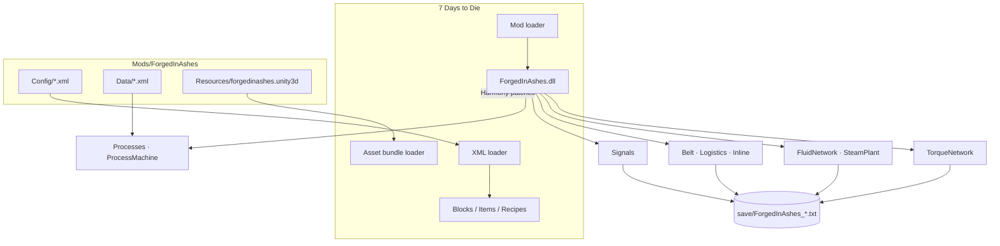
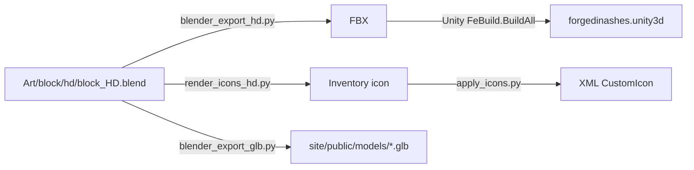

[← Documentation home](README.md) · **English** · [Português (Brasil)](../pt-BR/development.md) · [Español](../es/development.md)

# 🛠️ Development

Everything you need to build ForgedInAshes from source, understand how it works and change it safely.

## Prerequisites

| Tool | Version | Used for |
|---|---|---|
| Windows | 10 / 11 | The toolchain is PowerShell-based |
| 7 Days to Die | V3.4 (b10) | Game assemblies to compile against, and testing |
| .NET Framework | 4.x (`csc.exe`, ships with Windows) | Compiling the mod DLL (**C# 5**) |
| Python | 3.11+ (with Pillow) | Validators, data generators, documentation art |
| Blender | 5.3 | 3D models, icons, GLB export for the website |
| Unity | 2022.3.62f2 | Building the asset bundle from the FBX models |
| Node.js | 20+ | The tutorial website |

Write your game path in **`tools/game_path.txt`** (first line), for example
`C:\Program Files (x86)\Steam\steamapps\common\7 Days To Die`. The file is git-ignored.

> [!IMPORTANT]
> Game files are **never** committed. The build references the game's own assemblies in place, and the Harmony
> library comes from the game's `Mods/0_TFP_Harmony`.

## The `fe` tool

`fe.bat` (a wrapper around `tools/fe.ps1`) runs the repetitive work. Run it without arguments for a menu.

| Command | What it does |
|---|---|
| `fe.bat estado` | Shows what is out of date, changes nothing |
| `fe.bat modelos` | Re-exports changed Blender models to FBX and rebuilds the Unity asset bundle |
| `fe.bat icones` | Renders inventory icons of changed models and applies them to the XML |
| `fe.bat mod` | Runs the validators, compiles the DLL and links the mod into the game |
| `fe.bat tudo` | `modelos` → `icones` → `mod` |
| `fe.bat site` | Exports GLB models, regenerates the website data and builds the site |

Options: `-Modelos a,b` limits to some models, `-Forcar` redoes everything, `-Copiar` copies instead of linking,
`-Simular` shows what would happen.

> [!WARNING]
> Close the game before `fe.bat mod`: a running game locks `ForgedInAshes.dll`. To only check that the code
> compiles while the game is open, use `tools/build.ps1 -Out <another path>`.

## Repository layout

```text
ForgedInAshes/
├─ Mods/ForgedInAshes/          The mod exactly as the game loads it
│  ├─ ModInfo.xml
│  ├─ Config/                   XPath patches: blocks, items, recipes, localization, XUi windows
│  ├─ Data/                     Mod data read by the DLL: processes, settings, fallback recipes
│  ├─ Resources/                forgedinashes.unity3d (asset bundle, built by Unity)
│  └─ UIAtlases/ItemIconAtlas/  Inventory icons
├─ src/ForgedInAshes/           C# source of ForgedInAshes.dll
├─ tools/                       Build, install, validators, generators
├─ Art/                         Blender sources (per block) and Art/UnityProject
├─ site/                        Tutorial website (Vite + React + three.js)
└─ docs/                        Documentation (en · pt-BR · es) and its artwork
```

## Architecture



| Area | Main files |
|---|---|
| Entry point | `ModApi.cs` (`IModApi`, Harmony `PatchAll`, save-file helper), `Settings.cs` |
| Torque | `TorqueNetwork.cs` (networks, UT/RPM, overload, look text), `TorqueEngine.cs`, `TorqueCrank.cs`, `Crank.cs`, `KineticSpinner.cs` |
| Electricity | `Dynamo.cs`, `PowerPatches.cs`, `PowerGatePatches.cs`, `FuelGenerator.cs`, `WireMultiblock.cs` |
| Fluids and steam | `FluidNetwork.cs`, `FluidControl.cs`, `SteamEngine.cs`, `SteamPlant.cs`, `SteamVent.cs` |
| Items and belts | `Belt.cs`, `Logistics.cs`, `ItemTransport.cs`, `Inline.cs`, `MachineItems.cs`, `ConveyorStand.cs` |
| Production | `Processes.cs`, `ProcessMachine.cs`, `MetalWorks.cs`, `Industrial.cs`, `AutoCraft.cs`, `Pickup.cs` |
| World and signals | `WorldMachines.cs`, `Signals.cs`, `Display.cs` |
| UI | `FeUi.cs`, `RecipeBook.cs`, `UiWatchdog.cs`, `LookTextProbe.cs` |
| Visuals | `FxVisual.cs`, `MachineVisual.cs`, `CasterVisual.cs`, `CondenserVisual.cs`, `MotorSocketMarker.cs` |

### Key rules of the code

- **C# 5 only.** The DLL is compiled with the .NET Framework 4 `csc.exe` (`tools/build.ps1`): no string
  interpolation, no `?.`, no expression-bodied members.
- **Block and item IDs keep the `fe` prefix** (`feSteamTurbine`, `feConveyor`…). They are stored in player saves —
  renaming one breaks existing worlds.
- XML classes are referenced as `ForgedInAshes.<Class>, ForgedInAshes` (the game adds the `Block` prefix to block
  classes).
- Per-world state goes through `ForgedInAshesMod.SaveFile(name)`, which also migrates the files of the former name.
- When the game's behaviour is unclear, read its IL instead of guessing: `tools/il_inspect.ps1`
  (`-Method 'Type::Method'`, `-Type 'Type'`, `-Find 'regex'`).

## Validators

Run them before every commit (`fe.bat mod` runs the first four):

| Script | Checks |
|---|---|
| `tools/check_xpath.py` | Every XPath patch matches the vanilla XML |
| `tools/check_processes.py` | Processes, machines and fluids in `Data/fe_processes.xml` are consistent |
| `tools/check_phase3.py` | Progression and recipe rules |
| `tools/check_coverage.py` | Every vanilla craftable item has a production path |
| `tools/list_assets.py` | Blocks and items still missing a model or an icon (`PENDENCIAS_ASSETS.md`) |
| `tools/check_log.py` | Scans a game log for mod errors |

## Data generators

| Script | Produces |
|---|---|
| `tools/gen_chain.py` | The production chains: blocks, items, recipes, localization and `Data/fe_processes.xml` (writes between `BEGIN/END GENERATED` markers) |
| `tools/gen_ui.py` | XUi windows |
| `tools/gen_site.py` | `site/public/data/mod.json` and the website icons |
| `tools/gen_docs_art.py` | The documentation banner, social preview and machine strip |

## Asset pipeline



`fe.bat modelos`, `fe.bat icones` and `fe.bat site` run these steps only for what changed.

## Testing in game

1. `fe.bat mod` (game closed) — the mod is **linked**, so later XML edits only need a game restart.
2. Start the game without EAC and load a test world.
3. Read the log: every mod line starts with `[ForgedInAshes]`. Create `Mods/ForgedInAshes/debug.txt` for verbose
   output.
4. Record what you verified in `MODLOG.md`.

## The website

`site/` is a Vite + React app. Item, machine and production-line pages are generated from
`site/public/data/mod.json`; only the concept guides in `site/src/guides.js` are hand-written.

```powershell
cd site
npm install
npm run dev      # http://localhost:5173
```

Deploy on Vercel with the project root set to `site` (build `npm run build`, output `dist`).

---

[← Troubleshooting](troubleshooting.md) · [Contributing →](../../CONTRIBUTING.md)
