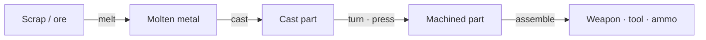
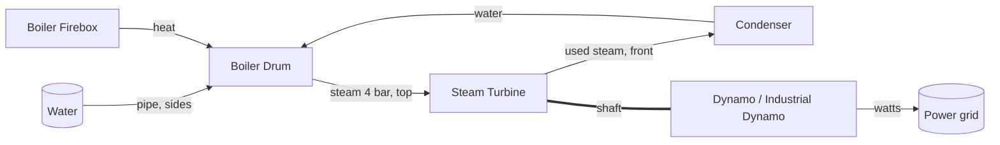

[← Documentation home](README.md) · **English** · [Português (Brasil)](../pt-BR/gameplay.md) · [Español](../es/gameplay.md)

# 🎮 Gameplay guide

ForgedInAshes turns crafting into **production lines**. Instead of one click at a workbench, a part changes shape
step by step, and every step needs a machine and a source of energy.

**Contents**

1. [Controls and reading machines](#1-controls-and-reading-machines)
2. [First steps](#2-first-steps)
3. [Torque](#3-torque)
4. [Fluids, gases and pressure](#4-fluids-gases-and-pressure)
5. [Conveyors and logistics](#5-conveyors-and-logistics)
6. [Steam power plant](#6-steam-power-plant)
7. [Signals and automation](#7-signals-and-automation)
8. [World machines](#8-world-machines)
9. [Resources: rubber, oil and chemistry](#9-resources-rubber-oil-and-chemistry)
10. [Giant machines: Mining Rig and Oil Extractor](#10-giant-machines-mining-rig-and-oil-extractor)
11. [Railways and trains](#11-railways-and-trains)

---

## 1. Controls and reading machines

| Action | What it does |
|---|---|
| **Look at a block** | Shows its live readout: RPM, load in UT, fluid and flow, what is missing. Works up to **4 m** (5 m for large machines). |
| **Tap E** | Runs the block's first command. |
| **Hold E** | Opens the radial menu: *Recipes*, *Choose recipe*, *Change setting*, *Settings*, *Network*, *Take*… |
| **Crouch + E** | On cranks: open or pick up instead of turning. |

Two tools make life easier:

| Item | Use |
|---|---|
| **Engineer's Manual** (`feEngineerManual`) | Use it (left click) to open the **Production Guide**: how every item of the game is made. |
| **Engineer's Wrench** (`feEngineerWrench`) | Hold it and hold E on a pipe, shaft, belt or machine: *Network* opens the **Network Panel**. |

## 2. First steps

1. **First torque.** A **Crank** stores energy as you hold E on it and sends **30 W** through wires; a
   **Torque Crank** gives torque directly while you turn it. A **Water Wheel** in a river gives **128 UT at
   16 RPM** for free.
2. **First benches.** The **Foundry** smelts metals and glass. The **Parts Press** makes plates, the **Lathe**
   makes shafts, gears, springs and mechanical parts, and the **Weapon and Tool Assembler** builds weapons and
   tools. Every machine except the Foundry needs torque in its **motor socket**: an **Electric Motor** next to
   it, an engine, a crank or a shaft.
3. **First line.** Fix a recipe (*hold E → Choose recipe*), bring the ingredients with **Conveyor Belts** and
   **Funnels**, and the machine works on its own. Crates touching the Assembler feed the chosen recipe.

> [!TIP]
> Open the Production Guide on any item: it shows the whole tree down to raw materials, the machines involved and
> the order of the steps.

## 3. Torque

Every connected group of shafts and machines is one **network**:

- **Capacity** = sum of what the sources offer (UT).
- **Load** = sum of what the machines cost (UT).
- **Load above capacity = OVERLOAD.** The network keeps turning for **20 s of start-up inertia**, then stops.
- **More RPM** makes machines faster, but the cost grows with the **square** of the speed.

### Transmission

| Block | Role |
|---|---|
| **Shaft** | Connects blocks in a straight line. |
| **Gearbox** | Distributes the spin to all six sides. |
| **Speed Box** | Changes the ratio: faster, or stronger. |
| **Clutch** | Separates part of the network (also by signal). |
| **Torque Regulator** | Limits how much one branch can draw. |
| **Spin Inverter** | Reverses the direction of rotation. |
| **Cogwheel** | Cogwheels side by side drive each other, no shaft between them. |
| **Torque Gauge** | Shows sources, machines, regulators and load. |

### Sources, from first to biggest

| Source | Output |
|---|---|
| **Torque Crank** | Torque while you turn it |
| **Water Wheel** | 128 UT at 16 RPM (add a Speed Box ×2 for 32 RPM machines) |
| **Windmill** | Free torque from the wind |
| **Electric Motor** | 128 UT from 30 W of electricity |
| **Coal Engine** · **Gas Engine** | Fuel-powered torque |
| **Steam Engine** | Up to 1024 UT — the cheap, simple workhorse (3×3 base, 2 high) |
| **Steam Turbine** | Up to 1024 UT each, stackable on one shaft — see the [power plant](#6-steam-power-plant) |

> [!NOTE]
> If a machine gets the wrong spin, turn the motor around or add a **Spin Inverter**. A network reported as
> **LOCKED** has sources turning against each other or at different speeds.

## 4. Fluids, gases and pressure

- A pipe network carries **one fluid at a time**. Two fluids meeting = **BLOCKED**.
- Liquids move with pumps. Gases have **pressure** in bar.
- The **Pipe** holds **4 bar**; the **High Pressure Pipe** holds **12 bar**. Above that, the pipe **leaks**.

| Block | Role |
|---|---|
| **Mechanical Pump** · **Hose Pulley** | Pull water from the world |
| **Liquid Tank** · **Gas Tank** | Tanks that touch merge into one. A Gas Tank holds 2,000 L at 1 bar, up to 10 bar |
| **Compressor** | Raises gas from low to high pressure |
| **Shut-off Valve** | Opens / closes (also by signal) |
| **One-way valve** | Lets fluid pass from its back to its front only |
| **Regulator Valve** | Limits the flow |
| **Fluid Separator** | Lets only one chosen fluid through |
| **Relief Valve** | Protects pipes from over-pressure |
| **Gauge** | Measures, and emits a signal at the chosen value |

> [!IMPORTANT]
> Process machines take fluids **in at the back (and bottom)** and send them **out at the top (and left/right)**.

## 5. Conveyors and logistics

**Conveyor Belts** run on torque: a shaft beside any belt of a line drives the whole line (**8 UT per belt**,
**1 block/s at 32 RPM**). Items enter machines from any side and leave on the belt in front.

| Block | Role |
|---|---|
| **Funnel** | Takes up to 16 items every half second from a crate or a machine's output and puts them on the belt |
| **Mechanical Arm** | Picks up behind, places in front, with filter and quantity |
| **Belt Splitter** | Splits items in a chosen ratio |
| **Belt Tunnel** | Sorts by item |
| **Filter Belt** | Sends one item to the sides |
| **Belt Gate** | Stops the line on a signal |
| **Counter Belt** | Emits a signal every N items |
| **Item Chute** | Moves items down (or up, with an Industrial Fan below) |
| **Depot** | Shows a stack and serves as the bench of in-line stations |
| **Item Vault** | Vaults that touch become one storage |

### In-line stations

Placed **on top of a belt**, they work on the item passing below — sequential assembly like a real factory:
**In-line Press**, **Dosing Nozzle**, **Inserter**, **Crimper**, **Wire Drawer**, **Grinder**, **Bending Press**,
**Welding Station** and **Reflow Oven**. The 9 mm ammunition line is the classic example: moulded casing, chemical
powder and assembly in sequence on the belt.

## 6. Steam power plant

The **Steam Engine** is the simple engine. When the factory grows, build a **power plant** of any size: it gives
torque *and* electricity.

1. **Boiler Firebox** — burns coal, charcoal, wood, shale or biofuel (belt, arm or hand), or fuel gas (pipe at its
   back), and heats the drums it touches.
2. **Boiler Drum** — water in by pipe on its **sides**, steam out on **top** at **4 bar**. Put the firebox
   **under** the drum: the bottom has no pipe port. Each lit firebox touching a drum boils **90 L/min**, up to
   **180 L/min per drum**. Drums that touch are **one boiler**.
3. **Steam Turbine** — steam in at the **back** (at least 1.5 bar), used steam out at the **front**. Gives up to
   **1024 UT at 32 RPM** with **240 L/min** of steam and uses steam according to the load. Turbines on the same
   shaft add up.
4. **Condenser** — 2×2; takes steam at the back of its top and returns water at the front of its bottom: up to
   120 L/min, 90 % back as water. Needs **120 W**.
5. **Dynamo** (128 UT → 60 W) or **Industrial Dynamo** (1024 UT → 500 W at 32 RPM) on the turbine shaft feeds the
   vanilla power grid.

> [!TIP]
> **Sizing:** 2 fireboxes per drum = 180 L/min. 4 drums and 8 fireboxes feed 3 turbines.

## 7. Signals and automation

A signal block powers the **six blocks touching it**. Shut-off valves, belt gates, clutches and pistons obey.

| Block | Role |
|---|---|
| **Signal Lever** | On / off |
| **Analog Lever** | Strength from 0 to 15 |
| **Signal Receiver** | Connects vanilla wiring (switches, timers, sensors) to mod blocks |
| **Wireless Transmitter / Receiver** | Linked at any distance when they hold the same frequency item |
| **Gauge** · **Counter Belt** | Emit signals too |
| **Display Panel** | Shows the number of the block behind it: pressure, tank, crate, RPM |

> [!TIP]
> Gauge on a gas tank + signal-driven shut-off valve on its input = the tank never exceeds its limit.

## 8. World machines

Torque machines that act on the block **in front** and deliver what they collect to the crate, belt or chute
**behind**:

| Block | Role |
|---|---|
| **Mechanical Drill** | Wears down stone, ore and soil |
| **Mechanical Saw** | Fells the whole tree |
| **Mechanical Harvester** | Harvests and replants |
| **Deployer** | Places blocks and seeds |
| **Mechanical Piston** | Pushes blocks on a signal |
| **Industrial Fan** | Washes (water in front), heats (lit burner in front) or pushes items |

## 9. Resources: rubber, oil and chemistry

### Rubber tree

Rubber trees do **not** spawn in the world — you make the sapling:

- **Rubber Tree (seed)** — made in the **Laboratory** (64 UT): 1 oak sapling, 1 acid, 2 mushrooms.
- Plant it like an oak, on **dirt, forest ground or a farm plot**. On sand, snow or desert it stops at the
  third stage.
- Place a **Sap Tapper** with its **back against the trunk**; latex drips out of its **front** into a pipe.

| Tree stage | Latex |
|---|---|
| Seed and first stage | — |
| Second stage | 1 L/min |
| Third stage | 1.5 L/min |
| Adult (fourth stage) | 2 L/min |
| Natural oak / maple | 0.3 L/min |

### Oil and chemistry

The **Refinery**, distillation towers, **Biodigesters**, washers, autoclaves and chemistry mixers turn crude oil,
biomass and minerals into fuels, plastics, rubber, acids and medicine. Use the Production Guide to follow any chain.

## 10. Giant machines: Mining Rig and Oil Extractor

> [!NOTE]
> New and not tested in game yet. Their 3D models are still being made: until then they borrow smaller models.

| Machine | Size | Power | What it does |
|---|---|---|---|
| **Mining Rig** | 7×7 base, 9 high | **2048 UT** in its motor socket | Works the whole chunk around it (radius 16), layer by layer down to bedrock. Stone, ores, sand, gravel and soil give their drops; every block that is not soil **becomes soil**, so the ground keeps its shape. The only hole is its drill shaft. Products leave by its **front** (belt, crate, chute) and it pauses while that is full. Each block is worked once: in the end it is exhausted. |
| **Oil Extractor** | 5×5 base, 11 high | **512 UT** in its motor socket | Place it near a shale vein (desert). It surveys the ground within 24 blocks **without breaking anything**; the shale it finds is its reserve (300 L of crude oil per shale block). It pumps 120 L/min out of its front at a pressure only the **High Pressure Pipe** stands. |
| **Storage Tank** | 5×5 base, 6 high | — | 100,000 L of one liquid; pipes on any outer side of its bottom layer. Send the crude oil here and on to the refinery. |

Hold E on a giant machine to switch it on or off; look at it for its progress, reserve and torque.

## 11. Railways and trains

> [!NOTE]
> New and not tested in game yet. Track, train and station models are still being made: until then the cars are coloured boxes.

**Track.** Pieces join where their ends meet: **Rail** (1 block), **Rail Curve** (90°, 5×5, radius 4.5 — turn it for any corner), **Rail Ramp** (up 1 over 3) and **Rail Switches** (left / right). Trains choose the branch their route needs; they never turn back except at stations. Trains **do not collide** — with each other or with anything.

**Stations.** The **Train Station** is a 9×3 platform placed **beside** the rails (trains stop at the nearest rail, up to 12 m away). Write its name on its label (hold E). It is a 100-slot storage with a 20,000 L tank:

- belts, arms and funnels fill or empty it like a crate; pipes on its outer sides fill or empty its tank;
- **mode Load**: arriving trains take its items and fluid (as much as the wagons hold); **mode Unload**: they leave theirs;
- its own **fuel store** (Coal, Gas Cans, Fuel Gas Canisters — no wood, charcoal or biofuel) refuels every train that stops; fill it by hand (hold E) or by belt.

**Trains.** Place a **Locomotive** on or within 4 m of a rail; place **wagons** within 10 m of it to couple them: **Cargo** (40 slots), **Tank** (20,000 L of one fluid), **Passenger** (look at it, E to ride, E or jump to get off). Look at the locomotive and press E for the **Train Panel**: a map of the rails and stations, the route (click stations to add them, click the route to remove), **Run / Stop**, refuel from your hand, pick the train up. The train then drives itself from station to station, waiting 12 s at each one.

---

[← Installation](installation.md) · Next: **[Troubleshooting →](troubleshooting.md)**
