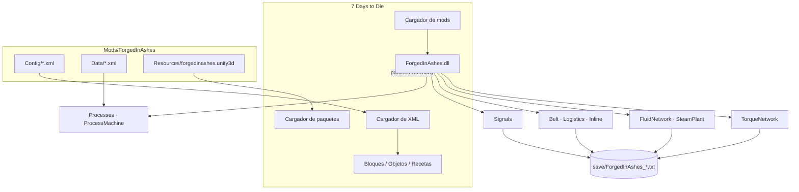
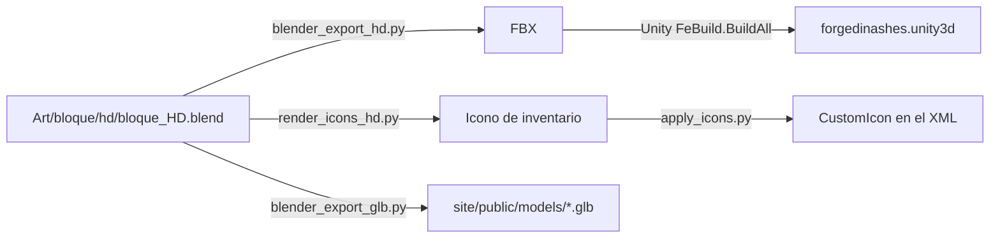

[← Inicio de la documentación](README.md) · [English](../en/development.md) · [Português (Brasil)](../pt-BR/development.md) · **Español**

# 🛠️ Desarrollo

Todo lo que necesitas para compilar ForgedInAshes desde el código fuente, entender cómo funciona y modificarlo con
seguridad.

## Requisitos previos

| Herramienta | Versión | Para qué |
|---|---|---|
| Windows | 10 / 11 | Las herramientas están en PowerShell |
| 7 Days to Die | V3.4 (b10) | Ensamblados del juego para compilar, y pruebas |
| .NET Framework | 4.x (`csc.exe`, viene con Windows) | Compilar la DLL del mod (**C# 5**) |
| Python | 3.11+ (con Pillow) | Validadores, generadores de datos, arte de la documentación |
| Blender | 5.3 | Modelos 3D, iconos, exportación GLB para el sitio |
| Unity | 2022.3.62f2 | Generar el paquete de modelos a partir de los FBX |
| Node.js | 20+ | El sitio de tutoriales |

Escribe la ruta del juego en **`tools/game_path.txt`** (primera línea), por ejemplo
`C:\Program Files (x86)\Steam\steamapps\common\7 Days To Die`. Git ignora este archivo.

> [!IMPORTANT]
> Los archivos del juego **nunca** se suben al repositorio. La compilación referencia los ensamblados del juego en
> su sitio, y Harmony viene de la carpeta `Mods/0_TFP_Harmony` del juego.

## La herramienta `fe`

`fe.bat` (que llama a `tools/fe.ps1`) hace el trabajo repetitivo. Ejecútalo sin argumentos para abrir un menú.

| Comando | Qué hace |
|---|---|
| `fe.bat estado` | Muestra lo que está desactualizado, sin cambiar nada |
| `fe.bat modelos` | Reexporta a FBX los modelos de Blender modificados y regenera el paquete de modelos en Unity |
| `fe.bat icones` | Renderiza los iconos de inventario de los modelos modificados y los aplica al XML |
| `fe.bat mod` | Ejecuta los validadores, compila la DLL y enlaza el mod en la carpeta del juego |
| `fe.bat tudo` | `modelos` → `icones` → `mod` |
| `fe.bat site` | Exporta los modelos GLB, regenera los datos y compila el sitio |

Opciones: `-Modelos a,b` limita a algunos modelos, `-Forcar` lo rehace todo, `-Copiar` copia en lugar de enlazar,
`-Simular` muestra lo que haría.

> [!WARNING]
> Cierra el juego antes de `fe.bat mod`: con el juego abierto, `ForgedInAshes.dll` queda bloqueada. Para solo
> comprobar que el código compila con el juego abierto, usa `tools/build.ps1 -Out <otra ruta>`.

## Estructura del repositorio

```text
ForgedInAshes/
├─ Mods/ForgedInAshes/          El mod exactamente como lo carga el juego
│  ├─ ModInfo.xml
│  ├─ Config/                   Parches XPath: bloques, objetos, recetas, traducciones, ventanas XUi
│  ├─ Data/                     Datos que lee la DLL: procesos, ajustes, recetas de reserva
│  ├─ Resources/                forgedinashes.unity3d (paquete de modelos, generado por Unity)
│  └─ UIAtlases/ItemIconAtlas/  Iconos de inventario
├─ src/ForgedInAshes/           Código C# de ForgedInAshes.dll
├─ tools/                       Compilación, instalación, validadores, generadores
├─ Art/                         Archivos de Blender (por bloque) y Art/UnityProject
├─ site/                        Sitio de tutoriales (Vite + React + three.js)
└─ docs/                        Documentación (en · pt-BR · es) y su arte
```

## Arquitectura



| Área | Archivos principales |
|---|---|
| Punto de entrada | `ModApi.cs` (`IModApi`, `PatchAll` de Harmony, archivos de partida), `Settings.cs` |
| Torque | `TorqueNetwork.cs` (redes, UT/RPM, sobrecarga, texto al mirar), `TorqueEngine.cs`, `TorqueCrank.cs`, `Crank.cs`, `KineticSpinner.cs` |
| Electricidad | `Dynamo.cs`, `PowerPatches.cs`, `PowerGatePatches.cs`, `FuelGenerator.cs`, `WireMultiblock.cs` |
| Fluidos y vapor | `FluidNetwork.cs`, `FluidControl.cs`, `SteamEngine.cs`, `SteamPlant.cs`, `SteamVent.cs` |
| Objetos y cintas | `Belt.cs`, `Logistics.cs`, `ItemTransport.cs`, `Inline.cs`, `MachineItems.cs`, `ConveyorStand.cs` |
| Producción | `Processes.cs`, `ProcessMachine.cs`, `MetalWorks.cs`, `Industrial.cs`, `AutoCraft.cs`, `Pickup.cs` |
| Mundo y señales | `WorldMachines.cs`, `Signals.cs`, `Display.cs` |
| Interfaz | `FeUi.cs`, `RecipeBook.cs`, `UiWatchdog.cs`, `LookTextProbe.cs` |
| Visuales | `FxVisual.cs`, `MachineVisual.cs`, `CasterVisual.cs`, `CondenserVisual.cs`, `MotorSocketMarker.cs` |

### Reglas principales del código

- **Solo C# 5.** La DLL se compila con el `csc.exe` de .NET Framework 4 (`tools/build.ps1`): sin interpolación de
  cadenas, sin `?.`, sin miembros con `=>`.
- **Los ID de bloques y objetos conservan el prefijo `fe`** (`feSteamTurbine`, `feConveyor`…). Quedan guardados en
  las partidas: renombrar uno rompe los mundos existentes.
- Las clases del XML se referencian como `ForgedInAshes.<Clase>, ForgedInAshes` (el juego añade el prefijo `Block`
  a las clases de bloque).
- El estado de cada mundo pasa por `ForgedInAshesMod.SaveFile(nombre)`, que también migra los archivos del nombre
  anterior.
- Cuando el comportamiento del juego no esté claro, lee su IL en lugar de adivinar: `tools/il_inspect.ps1`
  (`-Method 'Tipo::Metodo'`, `-Type 'Tipo'`, `-Find 'regex'`).

## Validadores

Ejecútalos antes de cada commit (`fe.bat mod` ejecuta los cuatro primeros):

| Script | Comprueba |
|---|---|
| `tools/check_xpath.py` | Cada parche XPath encuentra el XML del juego |
| `tools/check_processes.py` | Procesos, máquinas y fluidos de `Data/fe_processes.xml` son coherentes |
| `tools/check_phase3.py` | Reglas de progresión y recetas |
| `tools/check_coverage.py` | Cada objeto fabricable del juego tiene un camino de producción |
| `tools/list_assets.py` | Bloques y objetos que aún no tienen modelo o icono (`PENDENCIAS_ASSETS.md`) |
| `tools/check_log.py` | Busca errores del mod en un registro del juego |

## Generadores de datos

| Script | Genera |
|---|---|
| `tools/gen_chain.py` | Las cadenas de producción: bloques, objetos, recetas, traducciones y `Data/fe_processes.xml` (escribe entre las marcas `BEGIN/END GENERATED`) |
| `tools/gen_ui.py` | Ventanas XUi |
| `tools/gen_site.py` | `site/public/data/mod.json` y los iconos del sitio |
| `tools/gen_docs_art.py` | El banner, la vista previa social y la franja de máquinas de la documentación |

## Pipeline de assets



`fe.bat modelos`, `fe.bat icones` y `fe.bat site` solo rehacen lo que cambió.

## Probar en el juego

1. `fe.bat mod` (juego cerrado): el mod queda **enlazado** al repositorio, así que los cambios posteriores en el
   XML solo requieren reiniciar el juego.
2. Inicia el juego sin EAC y carga un mundo de prueba.
3. Lee el registro: cada línea del mod empieza por `[ForgedInAshes]`. Crea `Mods/ForgedInAshes/debug.txt` para el
   registro detallado.
4. Anota lo que verificaste en `MODLOG.md`.

## El sitio

`site/` es una aplicación Vite + React. Las páginas de objetos, máquinas y líneas de producción se generan a partir
de `site/public/data/mod.json`; solo las guías de conceptos de `site/src/guides.js` se escriben a mano.

```powershell
cd site
npm install
npm run dev      # http://localhost:5173
```

Publícalo en Vercel con la raíz del proyecto en `site` (compilación `npm run build`, salida `dist`).

---

[← Solución de problemas](troubleshooting.md) · [Cómo contribuir →](../../CONTRIBUTING.md)
