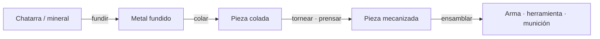
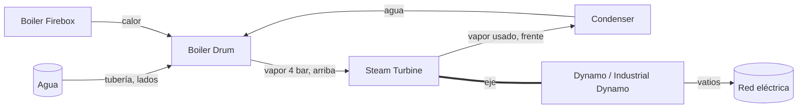

[← Inicio de la documentación](README.md) · [English](../en/gameplay.md) · [Português (Brasil)](../pt-BR/gameplay.md) · **Español**

# 🎮 Guía de juego

ForgedInAshes convierte la fabricación en **líneas de producción**. En lugar de un clic en el banco de trabajo, la
pieza cambia de forma paso a paso, y cada paso necesita una máquina y una fuente de energía.

> [!NOTE]
> Los bloques aparecen con su **nombre en inglés**, tal como se ven en el juego, seguido de una traducción la
> primera vez que se mencionan.

**Contenido**

1. [Controles y lectura de las máquinas](#1-controles-y-lectura-de-las-máquinas)
2. [Primeros pasos](#2-primeros-pasos)
3. [Torque](#3-torque)
4. [Fluidos, gases y presión](#4-fluidos-gases-y-presión)
5. [Cintas y logística](#5-cintas-y-logística)
6. [Central de vapor](#6-central-de-vapor)
7. [Señales y automatización](#7-señales-y-automatización)
8. [Máquinas en el mundo](#8-máquinas-en-el-mundo)
9. [Recursos: caucho, petróleo y química](#9-recursos-caucho-petróleo-y-química)

---

## 1. Controles y lectura de las máquinas

| Acción | Qué hace |
|---|---|
| **Mirar un bloque** | Muestra su lectura en vivo: RPM, carga en UT, fluido y caudal, lo que falta. Funciona hasta **4 m** (5 m en las máquinas grandes). |
| **Pulsar E** | Ejecuta el primer comando del bloque. |
| **Mantener E** | Abre el menú radial: *Recipes*, *Choose recipe*, *Change setting*, *Settings*, *Network*, *Take*… |
| **Agacharse + E** | En las manivelas: abrir o recoger en lugar de girar. |

Dos herramientas facilitan la vida:

| Objeto | Uso |
|---|---|
| **Engineer's Manual** (`feEngineerManual`, manual del ingeniero) | Úsalo (clic izquierdo) para abrir la **Guía de Producción**: cómo se fabrica cada objeto del juego. |
| **Engineer's Wrench** (`feEngineerWrench`, llave del ingeniero) | Sostenla y mantén E sobre una tubería, eje, cinta o máquina: *Network* abre el **Panel de Red**. |

## 2. Primeros pasos

1. **El primer torque.** La **Crank** (manivela) guarda energía mientras mantienes E sobre ella y envía **30 W**
   por cable; la **Torque Crank** (manivela de torque) da torque directo mientras la giras. La **Water Wheel**
   (rueda hidráulica) en un río da **128 UT a 16 RPM** gratis.
2. **Los primeros bancos.** La **Foundry** (fundición) funde metales y vidrio. La **Parts Press** (prensa de
   piezas) hace chapas, el **Lathe** (torno) hace ejes, engranajes, muelles y piezas mecánicas, y el **Weapon and
   Tool Assembler** (ensambladora) monta armas y herramientas. Todas, menos la Foundry, necesitan torque en su
   **toma de motor**: un **Electric Motor** (motor eléctrico) pegado, un motor de combustible, una manivela o un eje.
3. **La primera línea.** Fija una receta (*mantén E → Choose recipe*), trae los ingredientes con **Conveyor Belts**
   (cintas) y **Funnels** (embudos), y la máquina trabaja sola. Los cofres pegados a la ensambladora alimentan la
   receta elegida.

> [!TIP]
> Abre la Guía de Producción en cualquier objeto: muestra el árbol completo hasta las materias primas, las máquinas
> implicadas y el orden de los pasos.

## 3. Torque

Cada grupo conectado de ejes y máquinas es una **red**:

- **Capacidad** = suma de lo que ofrecen las fuentes (UT).
- **Carga** = suma de lo que consumen las máquinas (UT).
- **Carga mayor que la capacidad = SOBRECARGA.** La red sigue girando durante **20 s de inercia de arranque** y
  luego se detiene.
- **Más RPM** hace que las máquinas sean más rápidas, pero el coste crece con el **cuadrado** de la velocidad.

### Transmisión

| Bloque | Función |
|---|---|
| **Shaft** (eje) | Une bloques en línea recta. |
| **Gearbox** (caja de transmisión) | Reparte el giro a los seis lados. |
| **Speed Box** (caja de velocidad) | Cambia la relación: más rápido o más fuerte. |
| **Clutch** (embrague) | Separa parte de la red (también por señal). |
| **Torque Regulator** (regulador de torque) | Limita cuánto puede consumir una rama. |
| **Spin Inverter** (inversor de giro) | Invierte el sentido de rotación. |
| **Cogwheel** (engranaje) | Los engranajes uno al lado del otro se mueven entre sí, sin eje entre ellos. |
| **Torque Gauge** (medidor de torque) | Muestra fuentes, máquinas, reguladores y carga. |

### Fuentes, de la primera a la más grande

| Fuente | Salida |
|---|---|
| **Torque Crank** | Torque mientras la giras |
| **Water Wheel** | 128 UT a 16 RPM (añade una Speed Box ×2 para máquinas de 32 RPM) |
| **Windmill** (molino de viento) | Torque gratis del viento |
| **Electric Motor** | 128 UT a partir de 30 W de electricidad |
| **Coal Engine** · **Gas Engine** | Torque con combustible (carbón · gasolina) |
| **Steam Engine** (motor de vapor) | Hasta 1024 UT: el caballo de batalla barato y sencillo (base 3×3, 2 de alto) |
| **Steam Turbine** (turbina de vapor) | Hasta 1024 UT cada una, sumables en el mismo eje — ver la [central](#6-central-de-vapor) |

> [!NOTE]
> Si una máquina recibe el giro equivocado, gira el motor o añade un **Spin Inverter**. Una red **LOCKED**
> (bloqueada) tiene fuentes que giran una contra otra o a velocidades distintas.

## 4. Fluidos, gases y presión

- Una red de tuberías lleva **un fluido a la vez**. Dos fluidos que se encuentran = **BLOCKED** (bloqueada).
- Los líquidos se mueven con bombas. Los gases tienen **presión** en bar.
- La **Pipe** (tubería) aguanta **4 bar**; la **High Pressure Pipe** (tubería de alta presión) aguanta **12 bar**.
  Por encima, la tubería **pierde**.

| Bloque | Función |
|---|---|
| **Mechanical Pump** · **Hose Pulley** | Sacan agua del mundo (bomba mecánica · polea de manguera) |
| **Liquid Tank** · **Gas Tank** | Los tanques que se tocan se vuelven uno. El Gas Tank guarda 2.000 L a 1 bar, hasta 10 bar |
| **Compressor** | Lleva el gas de baja a alta presión |
| **Shut-off Valve** | Abre / cierra (también por señal) |
| **Válvula de un sentido** | Deja pasar solo de atrás hacia adelante |
| **Regulator Valve** | Limita el caudal |
| **Fluid Separator** | Deja pasar solo el fluido elegido |
| **Relief Valve** | Protege las tuberías del exceso de presión |
| **Gauge** (manómetro) | Mide y emite una señal en el valor elegido |

> [!IMPORTANT]
> Las máquinas de proceso reciben los fluidos **por detrás (y por abajo)** y los sueltan **por arriba (y a los
> lados)**.

## 5. Cintas y logística

Las **Conveyor Belts** funcionan con torque: un eje junto a cualquier cinta de la línea mueve la línea entera
(**8 UT por cinta**, **1 bloque/s a 32 RPM**). Los objetos entran en las máquinas por cualquier lado y salen por la
cinta de enfrente.

| Bloque | Función |
|---|---|
| **Funnel** (embudo) | Saca hasta 16 objetos cada medio segundo de un cofre o de la salida de una máquina y los pone en la cinta |
| **Mechanical Arm** (brazo mecánico) | Recoge detrás y coloca delante, con filtro y cantidad |
| **Belt Splitter** (divisor) | Reparte los objetos en una proporción |
| **Belt Tunnel** (túnel) | Separa por objeto |
| **Filter Belt** (cinta con filtro) | Envía un objeto hacia los lados |
| **Belt Gate** (compuerta) | Detiene la línea con una señal |
| **Counter Belt** (cinta contadora) | Emite una señal cada N objetos |
| **Item Chute** (tobogán) | Baja objetos (o los sube, con un Industrial Fan debajo) |
| **Depot** (depósito) | Muestra una pila y sirve de banco para las estaciones en línea |
| **Item Vault** (bóveda) | Las bóvedas que se tocan se vuelven un solo almacén |

### Estaciones en línea

Colocadas **sobre la cinta**, trabajan sobre el objeto que pasa por debajo — ensamblaje en secuencia, como en una
fábrica real: **In-line Press**, **Dosing Nozzle**, **Inserter**, **Crimper**, **Wire Drawer**, **Grinder**,
**Bending Press**, **Welding Station** y **Reflow Oven**. La línea de munición de 9 mm es el ejemplo clásico:
casquillo moldeado, pólvora química y ensamblaje en secuencia sobre la cinta.

## 6. Central de vapor

El **Steam Engine** es el motor sencillo. Cuando la fábrica crezca, construye una **central** del tamaño que
quieras: da torque *y* electricidad.

1. **Boiler Firebox** (hogar de caldera) — quema carbón, carbón vegetal, madera, esquisto o biocombustible (cinta,
   brazo o mano) o gas combustible (tubería por detrás) y calienta los calderines que toca.
2. **Boiler Drum** (calderín) — el agua entra por tubería en los **lados** y el vapor sale **arriba** a **4 bar**.
   Pon el hogar **debajo** del calderín: la cara inferior no tiene toma de tubería. Cada hogar encendido que lo toca
   hierve **90 L/min**, hasta **180 L/min por calderín**. Los calderines que se tocan son **una sola caldera**.
3. **Steam Turbine** — el vapor entra **por detrás** (al menos 1,5 bar) y el vapor usado sale **por delante**. Da
   hasta **1024 UT a 32 RPM** con **240 L/min** de vapor y consume según la carga. Las turbinas en el mismo eje se
   suman.
4. **Condenser** (condensador) — 2×2; recibe vapor detrás arriba y devuelve agua delante abajo: hasta 120 L/min,
   el 90 % vuelve como agua. Necesita **120 W**.
5. **Dynamo** (128 UT → 60 W) o **Industrial Dynamo** (1024 UT → 500 W a 32 RPM) en el eje de la turbina
   alimenta la red eléctrica del juego.

> [!TIP]
> **Dimensionado:** 2 hogares por calderín = 180 L/min. 4 calderines y 8 hogares alimentan 3 turbinas.

## 7. Señales y automatización

Un bloque de señal activa los **seis bloques que lo tocan**. Las válvulas de cierre, compuertas, embragues y
pistones obedecen.

| Bloque | Función |
|---|---|
| **Signal Lever** (palanca) | Encendido / apagado |
| **Analog Lever** (palanca analógica) | Intensidad de 0 a 15 |
| **Signal Receiver** (receptor) | Conecta el cableado del juego (interruptores, temporizadores, sensores) con los bloques del mod |
| **Wireless Transmitter / Receiver** | Quedan enlazados a cualquier distancia cuando tienen el mismo objeto de frecuencia |
| **Gauge** · **Counter Belt** | También emiten señal |
| **Display Panel** (panel numérico) | Muestra el número del bloque de detrás: presión, tanque, cofre, RPM |

> [!TIP]
> Manómetro en el tanque de gas + válvula de cierre por señal en la entrada = el tanque nunca supera su límite.

## 8. Máquinas en el mundo

Máquinas de torque que actúan sobre el bloque **de enfrente** y entregan lo que recogen en el cofre, la cinta o el
tobogán **de detrás**:

| Bloque | Función |
|---|---|
| **Mechanical Drill** (taladro) | Desgasta piedra, mineral y tierra |
| **Mechanical Saw** (sierra) | Tala el árbol entero |
| **Mechanical Harvester** (cosechadora) | Cosecha y vuelve a plantar |
| **Deployer** (colocador) | Coloca bloques y semillas |
| **Mechanical Piston** (pistón) | Empuja bloques con una señal |
| **Industrial Fan** (ventilador) | Lava (agua delante), calienta (quemador encendido delante) o empuja objetos |

## 9. Recursos: caucho, petróleo y química

### Árbol de caucho

El árbol de caucho **no** aparece en el mapa: tú fabricas el plantón.

- **Rubber Tree (seed)** — se fabrica en el **Laboratory** (laboratorio, 64 UT): 1 plantón de roble, 1 ácido,
  2 setas.
- Plántalo como un roble, en **tierra, suelo de bosque o parcela de cultivo**. En arena, nieve o desierto se detiene
  en la tercera etapa.
- Coloca un **Sap Tapper** (sangrador) con la **espalda contra el tronco**; el látex gotea por el **frente** hacia
  una tubería.

| Etapa del árbol | Látex |
|---|---|
| Plantón y primera etapa | — |
| Segunda etapa | 1 L/min |
| Tercera etapa | 1,5 L/min |
| Adulto (cuarta etapa) | 2 L/min |
| Roble / arce natural | 0,3 L/min |

### Petróleo y química

La **Refinery** (refinería), las torres de destilación, los **Biodigesters**, lavadoras, autoclaves y mezcladores
químicos transforman petróleo, biomasa y minerales en combustibles, plástico, caucho, ácidos y medicinas. Usa la
Guía de Producción para seguir cualquier cadena.

---

[← Instalación](installation.md) · Siguiente: **[Solución de problemas →](troubleshooting.md)**
