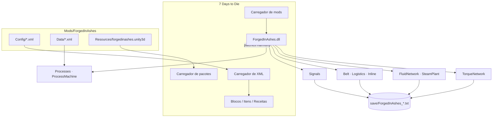
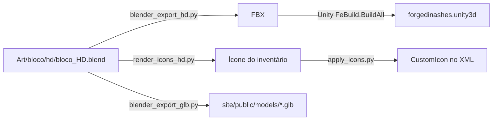

[← Início da documentação](README.md) · [English](../en/development.md) · **Português (Brasil)** · [Español](../es/development.md)

# 🛠️ Desenvolvimento

Tudo o que você precisa para compilar o ForgedInAshes do código-fonte, entender como ele funciona e mudá-lo com
segurança.

## Pré-requisitos

| Ferramenta | Versão | Para quê |
|---|---|---|
| Windows | 10 / 11 | As ferramentas são em PowerShell |
| 7 Days to Die | V3.4 (b10) | Assemblies do jogo para compilar, e testes |
| .NET Framework | 4.x (`csc.exe`, vem com o Windows) | Compilar a DLL do mod (**C# 5**) |
| Python | 3.11+ (com Pillow) | Validadores, geradores de dados, arte da documentação |
| Blender | 5.3 | Modelos 3D, ícones, exportação GLB para o site |
| Unity | 2022.3.62f2 | Gerar o pacote de modelos a partir dos FBX |
| Node.js | 20+ | O site de tutoriais |

Escreva o caminho do jogo em **`tools/game_path.txt`** (primeira linha), por exemplo
`C:\Program Files (x86)\Steam\steamapps\common\7 Days To Die`. O arquivo é ignorado pelo git.

> [!IMPORTANT]
> Arquivos do jogo **nunca** vão para o repositório. O build referencia os assemblies do jogo no lugar, e o Harmony
> vem da pasta `Mods/0_TFP_Harmony` do jogo.

## A ferramenta `fe`

O `fe.bat` (que chama `tools/fe.ps1`) faz o trabalho repetitivo. Rode sem argumentos para abrir um menu.

| Comando | O que faz |
|---|---|
| `fe.bat estado` | Mostra o que está desatualizado, sem mudar nada |
| `fe.bat modelos` | Reexporta os modelos do Blender alterados para FBX e refaz o pacote de modelos no Unity |
| `fe.bat icones` | Renderiza os ícones do inventário dos modelos alterados e aplica no XML |
| `fe.bat mod` | Roda os validadores, compila a DLL e liga o mod na pasta do jogo |
| `fe.bat tudo` | `modelos` → `icones` → `mod` |
| `fe.bat site` | Exporta os modelos GLB, regenera os dados e compila o site |

Opções: `-Modelos a,b` limita a alguns modelos, `-Forcar` refaz tudo, `-Copiar` copia em vez de ligar, `-Simular`
mostra o que faria.

> [!WARNING]
> Feche o jogo antes do `fe.bat mod`: com o jogo aberto, o `ForgedInAshes.dll` fica travado. Para só conferir se o
> código compila com o jogo aberto, use `tools/build.ps1 -Out <outro caminho>`.

## Estrutura do repositório

```text
ForgedInAshes/
├─ Mods/ForgedInAshes/          O mod exatamente como o jogo carrega
│  ├─ ModInfo.xml
│  ├─ Config/                   Patches XPath: blocos, itens, receitas, traduções, janelas XUi
│  ├─ Data/                     Dados lidos pela DLL: processos, configurações, receitas de reserva
│  ├─ Resources/                forgedinashes.unity3d (pacote de modelos, gerado pelo Unity)
│  └─ UIAtlases/ItemIconAtlas/  Ícones do inventário
├─ src/ForgedInAshes/           Código C# do ForgedInAshes.dll
├─ tools/                       Build, instalação, validadores, geradores
├─ Art/                         Arquivos do Blender (por bloco) e Art/UnityProject
├─ site/                        Site de tutoriais (Vite + React + three.js)
└─ docs/                        Documentação (en · pt-BR · es) e a arte dela
```

## Arquitetura



| Área | Arquivos principais |
|---|---|
| Ponto de entrada | `ModApi.cs` (`IModApi`, `PatchAll` do Harmony, arquivos do save), `Settings.cs` |
| Torque | `TorqueNetwork.cs` (redes, UT/RPM, sobrecarga, texto ao olhar), `TorqueEngine.cs`, `TorqueCrank.cs`, `Crank.cs`, `KineticSpinner.cs` |
| Eletricidade | `Dynamo.cs`, `PowerPatches.cs`, `PowerGatePatches.cs`, `FuelGenerator.cs`, `WireMultiblock.cs` |
| Fluidos e vapor | `FluidNetwork.cs`, `FluidControl.cs`, `SteamEngine.cs`, `SteamPlant.cs`, `SteamVent.cs` |
| Itens e esteiras | `Belt.cs`, `Logistics.cs`, `ItemTransport.cs`, `Inline.cs`, `MachineItems.cs`, `ConveyorStand.cs` |
| Produção | `Processes.cs`, `ProcessMachine.cs`, `MetalWorks.cs`, `Industrial.cs`, `AutoCraft.cs`, `Pickup.cs` |
| Mundo e sinais | `WorldMachines.cs`, `Signals.cs`, `Display.cs` |
| Interface | `FeUi.cs`, `RecipeBook.cs`, `UiWatchdog.cs`, `LookTextProbe.cs` |
| Visuais | `FxVisual.cs`, `MachineVisual.cs`, `CasterVisual.cs`, `CondenserVisual.cs`, `MotorSocketMarker.cs` |

### Regras principais do código

- **Só C# 5.** A DLL é compilada com o `csc.exe` do .NET Framework 4 (`tools/build.ps1`): sem interpolação de
  string, sem `?.`, sem membros com `=>`.
- **IDs de blocos e itens mantêm o prefixo `fe`** (`feSteamTurbine`, `feConveyor`…). Eles ficam gravados nos saves
  — renomear um quebra mundos existentes.
- Classes no XML são referenciadas como `ForgedInAshes.<Classe>, ForgedInAshes` (o jogo coloca o prefixo `Block`
  nas classes de bloco).
- O estado de cada mundo passa por `ForgedInAshesMod.SaveFile(nome)`, que também migra os arquivos do nome antigo.
- Quando o comportamento do jogo não estiver claro, leia o IL dele em vez de adivinhar: `tools/il_inspect.ps1`
  (`-Method 'Tipo::Metodo'`, `-Type 'Tipo'`, `-Find 'regex'`).

## Validadores

Rode antes de cada commit (o `fe.bat mod` roda os quatro primeiros):

| Script | Confere |
|---|---|
| `tools/check_xpath.py` | Todo patch XPath encontra o XML do jogo |
| `tools/check_processes.py` | Processos, máquinas e fluidos de `Data/fe_processes.xml` são coerentes |
| `tools/check_phase3.py` | Regras de progressão e receitas |
| `tools/check_coverage.py` | Todo item fabricável do jogo tem um caminho de produção |
| `tools/list_assets.py` | Blocos e itens ainda sem modelo ou ícone (`PENDENCIAS_ASSETS.md`) |
| `tools/check_log.py` | Procura erros do mod num log do jogo |

## Geradores de dados

| Script | Gera |
|---|---|
| `tools/gen_chain.py` | As cadeias de produção: blocos, itens, receitas, traduções e `Data/fe_processes.xml` (escreve entre as marcas `BEGIN/END GENERATED`) |
| `tools/gen_ui.py` | Janelas XUi |
| `tools/gen_site.py` | `site/public/data/mod.json` e os ícones do site |
| `tools/gen_docs_art.py` | O banner, a prévia social e a faixa de máquinas da documentação |

## Pipeline de assets



`fe.bat modelos`, `fe.bat icones` e `fe.bat site` só refazem o que mudou.

## Testar no jogo

1. `fe.bat mod` (jogo fechado) — o mod fica **ligado** ao repositório, então mudanças no XML depois só pedem
   reiniciar o jogo.
2. Abra o jogo sem EAC e carregue um mundo de teste.
3. Leia o log: toda linha do mod começa com `[ForgedInAshes]`. Crie `Mods/ForgedInAshes/debug.txt` para o log
   detalhado.
4. Registre o que você verificou no `MODLOG.md`.

## O site

`site/` é um app Vite + React. As páginas de itens, máquinas e linhas de produção são geradas de
`site/public/data/mod.json`; só os guias de conceito em `site/src/guides.js` são escritos à mão.

```powershell
cd site
npm install
npm run dev      # http://localhost:5173
```

Publique na Vercel com a raiz do projeto em `site` (build `npm run build`, saída `dist`).

---

[← Solução de problemas](troubleshooting.md) · [Como contribuir →](../../CONTRIBUTING.md)
