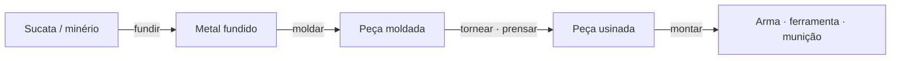
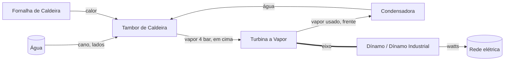

[← Início da documentação](README.md) · [English](../en/gameplay.md) · **Português (Brasil)** · [Español](../es/gameplay.md)

# 🎮 Guia de jogo

O ForgedInAshes transforma a fabricação em **linhas de produção**. Em vez de um clique na bancada, a peça muda de
forma etapa por etapa, e cada etapa precisa de uma máquina e de uma fonte de energia.

**Conteúdo**

1. [Controles e leitura das máquinas](#1-controles-e-leitura-das-máquinas)
2. [Primeiros passos](#2-primeiros-passos)
3. [Torque](#3-torque)
4. [Fluidos, gases e pressão](#4-fluidos-gases-e-pressão)
5. [Esteiras e logística](#5-esteiras-e-logística)
6. [Usina termelétrica](#6-usina-termelétrica)
7. [Sinais e automação](#7-sinais-e-automação)
8. [Máquinas no mundo](#8-máquinas-no-mundo)
9. [Recursos: borracha, petróleo e química](#9-recursos-borracha-petróleo-e-química)

---

## 1. Controles e leitura das máquinas

| Ação | O que faz |
|---|---|
| **Olhar para um bloco** | Mostra a leitura ao vivo: RPM, carga em UT, fluido e vazão, o que está faltando. Funciona até **4 m** (5 m nas máquinas grandes). |
| **Tocar E** | Executa o primeiro comando do bloco. |
| **Segurar E** | Abre o menu radial: *Receitas*, *Escolher receita*, *Trocar ajuste*, *Configurações*, *Rede*, *Pegar*… |
| **Agachar + E** | Nas manivelas: abrir ou pegar em vez de girar. |

Duas ferramentas facilitam a vida:

| Item | Uso |
|---|---|
| **Manual do Engenheiro** (`feEngineerManual`) | Use (clique esquerdo) para abrir o **Guia de Produção**: como cada item do jogo é feito. |
| **Chave de Engenheiro** (`feEngineerWrench`) | Segure-a e segure E num cano, eixo, esteira ou máquina: *Rede* abre o **Painel de Rede**. |

## 2. Primeiros passos

1. **Primeiro torque.** A **Manivela** guarda energia enquanto você segura E nela e manda **30 W** pelo fio; a
   **Manivela de Torque** dá torque direto enquanto você gira. A **Roda d'água** num rio dá **128 UT a 16 RPM**
   de graça.
2. **Primeiras bancadas.** A **Fundição** funde metais e vidro. A **Prensa de Peças** faz chapas, o **Torno** faz
   eixos, engrenagens, molas e peças mecânicas, e a **Montadora de Armas e Ferramentas** monta armas e
   ferramentas. Todas, menos a Fundição, precisam de torque no **encaixe de motor**: um **Motor Elétrico**
   encostado, um motor a combustível, uma manivela ou um eixo.
3. **Primeira linha.** Fixe uma receita (*segure E → Escolher receita*), traga os ingredientes com **Esteiras** e
   **Funis**, e a máquina trabalha sozinha. Baús encostados na Montadora alimentam a receita escolhida.

> [!TIP]
> Abra o Guia de Produção em qualquer item: ele mostra a árvore inteira até as matérias-primas, as máquinas
> envolvidas e a ordem das etapas.

## 3. Torque

Cada grupo ligado de eixos e máquinas é uma **rede**:

- **Capacidade** = soma do que as fontes oferecem (UT).
- **Carga** = soma do que as máquinas gastam (UT).
- **Carga acima da capacidade = SOBRECARGA.** A rede continua girando por **20 s de inércia de partida** e depois
  para.
- **Mais RPM** deixa as máquinas mais rápidas, mas o custo cresce com o **quadrado** da velocidade.

### Transmissão

| Bloco | Função |
|---|---|
| **Eixo** | Liga blocos em linha reta. |
| **Caixa de Transmissão** | Distribui o giro para os seis lados. |
| **Caixa de Velocidade** | Muda a relação: mais rápido ou mais forte. |
| **Embreagem** | Separa parte da rede (também por sinal). |
| **Regulador de Torque** | Limita quanto um ramo pode puxar. |
| **Inversor de Giro** | Inverte o sentido de rotação. |
| **Engrenagem** | Engrenagens lado a lado giram uma à outra, sem eixo entre elas. |
| **Medidor de Torque** | Mostra fontes, máquinas, reguladores e carga. |

### Fontes, da primeira à maior

| Fonte | Saída |
|---|---|
| **Manivela de Torque** | Torque enquanto você gira |
| **Roda d'água** | 128 UT a 16 RPM (coloque uma Caixa de Velocidade ×2 para máquinas de 32 RPM) |
| **Moinho de Vento** | Torque grátis do vento |
| **Motor Elétrico** | 128 UT a partir de 30 W de eletricidade |
| **Motor a Carvão** · **Motor a Gasolina** | Torque a combustível |
| **Motor a Vapor** | Até 1024 UT — o quebra-galho barato e simples (base 3×3, 2 de altura) |
| **Turbina a Vapor** | Até 1024 UT cada, somáveis no mesmo eixo — veja a [usina](#6-usina-termelétrica) |

> [!NOTE]
> Se uma máquina recebe o giro errado, vire o motor ou coloque um **Inversor de Giro**. Uma rede **TRAVADA** tem
> fontes girando uma contra a outra ou em velocidades diferentes.

## 4. Fluidos, gases e pressão

- Uma rede de canos leva **um fluido por vez**. Dois fluidos se encontrando = **BLOQUEADO**.
- Líquidos andam com bombas. Gases têm **pressão** em bar.
- O **Cano** aguenta **4 bar**; o **Cano de Alta Pressão** aguenta **12 bar**. Acima disso o cano **vaza**.

| Bloco | Função |
|---|---|
| **Bomba Mecânica** · **Polia de Mangueira** | Puxam água do mundo |
| **Tanque de Líquido** · **Tanque de Gás** | Tanques encostados viram um só. O Tanque de Gás guarda 2.000 L a 1 bar, até 10 bar |
| **Compressor** | Leva gás de baixa para alta pressão |
| **Registro** | Abre / fecha (também por sinal) |
| **Válvula de um sentido** | Deixa passar só de trás para a frente |
| **Válvula Reguladora** | Limita a vazão |
| **Separador de Fluido** | Deixa passar só o fluido escolhido |
| **Válvula de Alívio** | Protege os canos de pressão demais |
| **Manômetro** | Mede e dá sinal no valor escolhido |

> [!IMPORTANT]
> Máquinas de processo recebem fluidos **atrás (e embaixo)** e os soltam **em cima (e à esquerda/direita)**.

## 5. Esteiras e logística

As **Esteiras** andam com torque: um eixo do lado de qualquer esteira da linha move a linha inteira (**8 UT por
esteira**, **1 bloco/s a 32 RPM**). Itens entram nas máquinas por qualquer lado e saem na esteira da frente.

| Bloco | Função |
|---|---|
| **Funil** | Tira até 16 itens a cada meio segundo de um baú ou da saída de uma máquina e põe na esteira |
| **Braço Mecânico** | Pega atrás e põe na frente, com filtro e quantidade |
| **Divisor de Esteira** | Divide os itens numa proporção |
| **Túnel de Esteira** | Separa por item |
| **Esteira com Filtro** | Manda um item para os lados |
| **Comporta de Esteira** | Para a linha com sinal |
| **Esteira Contadora** | Dá um sinal a cada N itens |
| **Calha Vertical** | Leva itens para baixo (ou para cima, com um Ventilador Industrial embaixo) |
| **Depósito** | Mostra uma pilha e serve de bancada para as estações em linha |
| **Cofre Modular** | Cofres encostados viram um armazém só |

### Estações em linha

Colocadas **em cima da esteira**, trabalham no item que passa por baixo — montagem em sequência, como numa fábrica
de verdade: **Prensa em Linha**, **Bico Dosador**, **Encaixador**, **Crimpadora**, **Trefila**, **Esmeril**,
**Dobradeira**, **Soldadora** e **Forno de Refusão**. A linha da munição 9 mm é o exemplo clássico: estojo moldado,
pólvora química e montagem em sequência sobre a esteira.

## 6. Usina termelétrica

O **Motor a Vapor** é o motor simples. Quando a fábrica crescer, monte uma **usina** do tamanho que quiser: ela dá
torque *e* eletricidade.

1. **Fornalha de Caldeira** — queima carvão, carvão vegetal, madeira, xisto ou biocombustível (esteira, braço ou
   mão) ou gás combustível (cano atrás) e aquece os tambores encostados.
2. **Tambor de Caldeira** — água entra por cano nos **lados**, vapor sai **em cima** a **4 bar**. Coloque a
   fornalha **embaixo** do tambor: a face de baixo não tem entrada de cano. Cada fornalha acesa encostada ferve
   **90 L/min**, até **180 L/min por tambor**. Tambores encostados são **uma caldeira só**.
3. **Turbina a Vapor** — vapor entra **atrás** (pelo menos 1,5 bar), vapor usado sai **na frente**. Dá até
   **1024 UT a 32 RPM** com **240 L/min** de vapor e gasta conforme a carga. Turbinas no mesmo eixo se somam.
4. **Condensadora** — 2×2; recebe vapor atrás em cima e devolve água na frente embaixo: até 120 L/min, 90 %
   volta como água. Precisa de **120 W**.
5. **Dínamo** (128 UT → 60 W) ou **Dínamo Industrial** (1024 UT → 500 W a 32 RPM) no eixo da turbina alimenta a
   rede elétrica do jogo.

> [!TIP]
> **Dimensionamento:** 2 fornalhas por tambor = 180 L/min. 4 tambores e 8 fornalhas alimentam 3 turbinas.

## 7. Sinais e automação

Um bloco de sinal liga os **seis blocos encostados** nele. Registros, comportas, embreagens e pistões obedecem.

| Bloco | Função |
|---|---|
| **Alavanca de Sinal** | Liga / desliga |
| **Alavanca Analógica** | Força de 0 a 15 |
| **Receptor de Sinal** | Liga a fiação do jogo (interruptores, timers, sensores) aos blocos do mod |
| **Transmissor / Receptor sem Fio** | Ficam ligados a qualquer distância quando têm o mesmo item de frequência |
| **Manômetro** · **Esteira Contadora** | Também dão sinal |
| **Painel Numérico** | Mostra o número do bloco de trás: pressão, tanque, baú, RPM |

> [!TIP]
> Manômetro no tanque de gás + registro por sinal na entrada = o tanque nunca passa do limite.

## 8. Máquinas no mundo

Máquinas de torque que agem no bloco **da frente** e entregam o que coletam no baú, esteira ou calha **de trás**:

| Bloco | Função |
|---|---|
| **Furadeira Mecânica** | Desgasta pedra, minério e terra |
| **Serra Mecânica** | Derruba a árvore inteira |
| **Colheitadeira Mecânica** | Colhe e replanta |
| **Aplicador** | Coloca blocos e sementes |
| **Pistão Mecânico** | Empurra blocos com sinal |
| **Ventilador Industrial** | Lava (água na frente), aquece (queimador aceso na frente) ou empurra itens |

## 9. Recursos: borracha, petróleo e química

### Seringueira

A seringueira **não** nasce no mapa — você fabrica a muda:

- **Seringueira (muda)** — feita no **Laboratório** (64 UT): 1 muda de carvalho, 1 ácido, 2 cogumelos.
- Plante como um carvalho, em **terra, chão de floresta ou lote de plantio**. Em areia, neve ou deserto ela para no
  terceiro estágio.
- Coloque um **Sangrador de Seiva** com as **costas encostadas no tronco**; o látex pinga pela **frente** no cano.

| Estágio da árvore | Látex |
|---|---|
| Muda e primeiro estágio | — |
| Segundo estágio | 1 L/min |
| Terceiro estágio | 1,5 L/min |
| Adulta (quarto estágio) | 2 L/min |
| Carvalho / bordo natural | 0,3 L/min |

### Petróleo e química

A **Refinaria**, as torres de destilação, os **Biodigestores**, lavadoras, autoclaves e misturadores químicos
transformam petróleo, biomassa e minerais em combustíveis, plástico, borracha, ácidos e remédios. Use o Guia de
Produção para seguir qualquer cadeia.

---

[← Instalação](installation.md) · Próximo: **[Solução de problemas →](troubleshooting.md)**
